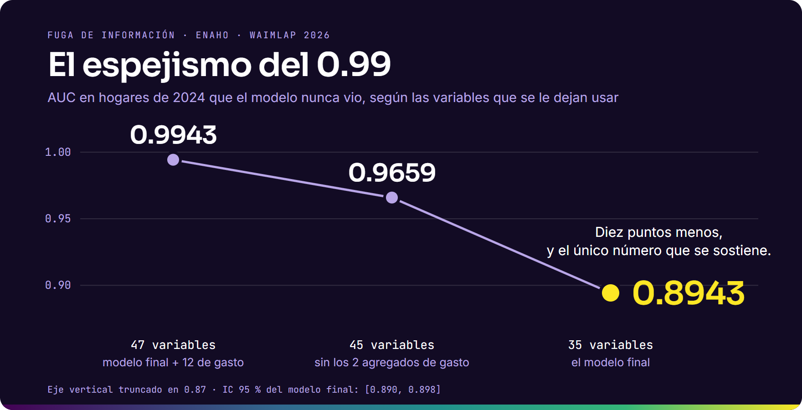

La mayoría de los datos llegan incompletos, sesgados o mal medidos. Mi trabajo es mostrar qué se puede afirmar con ellos y qué no.

**[Newsletter](https://www.jordandataexpert.com/newsletter)** · [Sitio](https://www.jordandataexpert.com) · [LinkedIn](https://www.linkedin.com/in/jordanrodriguezmallqui/) · [YouTube](https://www.youtube.com/@jordanrodriguezmallqui) · [X](https://x.com/jordanrmallqui) · [ORCID](https://orcid.org/0000-0002-2241-7988)

## Un caso

Entrenamos un score de capacidad económica para hogares peruanos con la ENAHO 2022–2023 y lo evaluamos en hogares de 2024 que el modelo nunca vio. Devolverle 12 variables de gasto sube el AUC de 0.894 a 0.994. Eso no es un modelo mejor: es fuga de información.

Paper aceptado en WAIMLAp 2026 (Springer), con Luis Sánchez Alvarado.

[El caso completo](https://www.jordandataexpert.com/investigacion) · [Las cifras, verificables](https://github.com/jordanrodriguezmallqui/espejismo-auc) · [Código, modelo y resultados en Zenodo](https://doi.org/10.5281/zenodo.23008789)

## Lo que enseño, abierto

| Curso | Programa | Qué cubre |
|---|---|---|
| [Taller MLOps en la práctica](https://github.com/jordanrodriguezmallqui/taller-mlops-uni) | Especialización en Ciencia de Datos, UNI | Del notebook a producción: MLflow, FastAPI, Docker, GitHub Actions y monitoreo de drift |
| [Machine Learning Supervisado](https://github.com/jordanrodriguezmallqui/ml-supervisado-uni) | Especialización en Ciencia de Datos, UNI | Pipelines, árboles y ensembles, optimización para negocio, explicabilidad y producción |
| [Modern Data Web Apps](https://github.com/jordanrodriguezmallqui/modern-data-apps) | Curso abierto | Aplicaciones analíticas con Dash, Streamlit y Gradio |
| [Fundamentos de Python y R](https://github.com/jordanrodriguezmallqui/fundamentos-python-r-pebiba-2026) | PEBIBA, UNI 2026 | De Excel y SQL a un primer pipeline reproducible, con Python y R lado a lado |

## Dónde estoy

- **Industria:** Senior Manager Pricing Analytics & Data en BBVA Perú.
- **Investigación:** doctorando en Ciencias e Ingeniería Estadística en la UNI.
- **Docencia:** programas de especialización en ciencia de datos y analítica de la UNI.

Python · R · SQL · PySpark · AWS · MLflow · FastAPI · Docker · Git

---

In English: applied statistics and data science for decisions with imperfect data, in banking, research and teaching.
